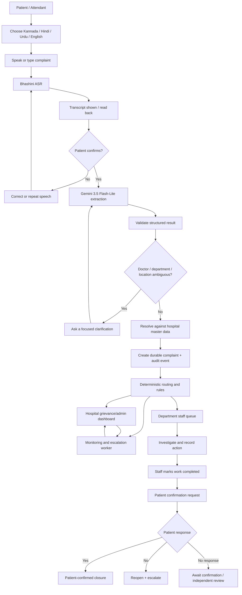

# Arogya Awaaz — Complete System Workflow

This document describes the full path from a patient speaking to the voice assistant through AI processing, grievance management, department action, hospital oversight, and patient-confirmed closure. It also documents exceptional paths for emergencies, doctor availability, medicine shortages, repeat complaints, and CPGRAMS referral.

## 1. End-to-end workflow at a glance

## 2. Stage 1 — Patient entry and language selection

**Actor:** Patient or attendant.  
**Interface:** Mobile web page, QR entry point, or hospital kiosk.

1. Patient opens the Arogya Awaaz page.
2. Patient selects Kannada, Hindi, Urdu, or English. Language auto-detection may be offered, but manual selection remains available.
3. The system displays a clear microphone control and a text-entry alternative.
4. Patient speaks naturally. Examples:
   - “I have been waiting for three hours for my diagnostic test.”
   - “The doctor is not available.”
   - “हड्डी का डॉक्टर नहीं है।”
   - “The medicine prescribed to me is out of stock.”
   - “The washroom near the general ward is dirty.”
   - “Staff are not responding to my complaint.”
5. If the patient does not want to share contact details, the patient can continue anonymously.

**System guarantees:** A contact number is optional. The patient is told when the microphone is active. The system does not claim that a complaint has been registered merely because the patient pressed the microphone button.

## 3. Stage 2 — Voice Assistant and Bhashini speech recognition

**Components:** React voice UI → FastAPI speech endpoint → Bhashini ASR adapter.

1. The browser captures audio after permission is granted.
2. Audio is sent securely to FastAPI. Provider credentials remain on the server.
3. FastAPI sends the audio to the configured Bhashini ASR service for the selected language.
4. Bhashini returns a transcript and any available metadata.
5. The interface displays the transcript and reads it back using Bhashini TTS where configured.
6. Patient chooses **Confirm**, **Edit**, or **Repeat**.
7. If ASR fails, times out, or does not support the language/audio, the user can type the complaint or retry.

**Important:** The confirmed transcript is stored separately from the raw ASR transcript so later reviewers can see whether the patient corrected a recognition error. Raw audio is not retained by default.

## 4. Stage 3 — AI processing and structured extraction

**Component:** Gemini 3.5 Flash-Lite through a backend adapter.  
**Model ID:** `gemini-3.5-flash-lite`.

The model receives the patient-confirmed transcript, selected language, allowed category list, and the minimum relevant hospital directory context. It returns a structured draft.

### Example 1 — Doctor/specialty mention

Patient says:

> “Haddi ka doctor nahi hai. I was waiting in orthopedics.”

Expected extraction:

- Category: `DOCTOR_AVAILABILITY`
- Specialty candidate: `ORTHOPEDICS`
- Location: Orthopedics OPD, if confirmed by the patient or kiosk context
- Doctor name: `null` unless the patient spoke a name or a unique directory match exists
- Verification state: `UNVERIFIED_REPORT`

The backend searches the approved doctor directory and its multilingual aliases. If exactly one match is found, the system can attach that doctor record. If several doctors match, it asks the patient to clarify. If no match is found, it routes the complaint to the Orthopedics department for human triage.

### Example 2 — Doctor Vikas

If the patient specifically says “Doctor Vikas in Orthopedics is not available”, and the hospital directory contains one matching Doctor Vikas in that specialty, the system may attach that doctor record.

Patient-facing response:

> “आपने बताया कि Orthopedic विभाग के Doctor Vikas उपलब्ध नहीं थे। आपकी शिकायत दर्ज कर दी गई है। अस्पताल की टीम उनकी ड्यूटी और उपलब्धता की जाँच करेगी।”

The assistant says that the patient reported unavailability. It does not assert that Doctor Vikas was definitely absent.

### Example 3 — Medicine stock-out

Patient says:

> “The medicine given in my prescription is not available at the hospital pharmacy.”

Expected extraction:

- Category: `MEDICINE_AVAILABILITY`
- Medicine name/strength/form: only fields actually stated or confirmed
- Primary department: Pharmacy/Stores
- Register action: create a Medicine Shortage Register row linked to the complaint
- Inventory status: `REPORTED`, not `VERIFIED_OUT_OF_STOCK`

### Validation layer

Before saving any final fields, FastAPI:

- validates the JSON against Pydantic enums and schemas;
- checks that hospital, department, doctor, and medicine references exist where required;
- resolves names against master data;
- rejects unknown officer names or unsupported categories;
- asks for clarification when required fields are ambiguous;
- retains the patient-confirmed words.

Gemini does not write directly to the database, assign staff, mark stock status verified, or close a complaint.

## 5. Stage 4 — Grievance management and registration

Once the patient confirms the structured summary, the backend creates the complaint.

### Registration transaction

1. Validate the request and idempotency key.
2. Generate internal UUID and unguessable public reference/token.
3. Insert the complaint row.
4. Insert the initial `SUBMITTED` event into the audit history.
5. Insert category-specific linked records where appropriate, such as doctor availability report or medicine shortage record.
6. Apply deterministic department routing.
7. Insert assignment and notification events.
8. Commit the transaction.
9. Return the public reference to the patient only after the commit succeeds.

If a request is retried after a network interruption, the same idempotency key returns the existing ticket rather than creating a duplicate. If the database is unavailable, the patient is told that the report is pending/retryable, not successfully registered.

### Ticket reference

The patient receives a short reference and a private QR/token for follow-up. The public reference is not a password; the private token or a second proof step is required to access private status details.

## 6. Stage 5 — Routing to department staff

The deterministic routing engine maps category and subcategory to the hospital's configured department and role.

| Issue | Primary route | Escalation/oversight |
|---|---|---|
| Diagnostic delay | Diagnostics / concerned OPD | Department supervisor / grievance officer |
| Doctor unavailable | Relevant specialty department | Medical Superintendent / designated higher officer |
| Medicine out of stock | Pharmacy / Stores / Procurement | Pharmacy head / hospital administrator |
| Unhygienic washroom | Housekeeping | Facilities supervisor / grievance officer |
| Broken facility | Facilities / Maintenance | Engineering or facilities head |
| Rude staff / misconduct | Restricted grievance-management queue | Grievance officer / authorised hospital administrator |
| Billing delay | Billing | Billing supervisor |
| Registration delay | Registration | Registration supervisor |
| Language/accessibility issue | Patient-relations / accessibility coordinator | Grievance officer |

A routing table is hospital configuration. The AI may suggest a category; it must not invent the department name or officer.

Staff receive a ticket with:

- public reference;
- neutral summary;
- original confirmed transcript;
- language;
- category and urgency suggestion;
- location and department;
- doctor/medicine match if confirmed;
- time received and due time;
- current status and previous events.

## 7. Stage 6 — Hospital dashboard and staff action

### Department staff

1. Staff logs in.
2. Staff sees only tickets authorised for their department/role.
3. Staff acknowledges the ticket.
4. Staff updates status and adds meaningful progress notes.
5. Staff records action taken and may reassign with a reason.
6. When work is complete, staff selects **Mark work completed** and enters an action note.

### Grievance officer / hospital administrator

The higher-level dashboard shows:

- all open, overdue, escalated, and reopened tickets;
- categories and affected locations;
- doctor-availability reports and verification state;
- medicine shortages and repeated stock-out reports;
- complaint volume by department;
- average acknowledgement and resolution times;
- unresolved clusters and patient dissatisfaction;
- action/audit timeline.

Complaint records are not hidden because a staff member marks them resolved. Changes are appended to the audit history.

## 8. Stage 7 — Doctor availability tracking and escalation

Doctor availability is a dedicated monitoring workflow, not merely an AI label.

### Data required

- doctor directory ID;
- specialty/department;
- duty date;
- duty roster start/end;
- exact patient report time;
- assigned two-hour bucket;
- optional appointment/scheduled-session detail;
- verification state and verifying authority.

### Example duty day

Doctor's configured duty shift: 09:00–17:00.

| Reported time | Two-hour bucket | Result |
|---|---|---|
| 09:20 | 09:00–11:00 | Affected bucket 1 |
| 11:40 | 11:00–13:00 | Affected bucket 2 |
| 16:30 | 15:00–17:00 | Affected bucket 4 |

These reports affect three distinct buckets. The third affected bucket triggers higher-authority review. Separately, three independent complaint submissions about the same doctor on the same duty day also trigger review even if they are in fewer buckets.

### Escalation sequence

1. First report → create unverified incident and send to department supervisor.
2. Additional reports → append to same doctor/date monitoring view; preserve each complaint separately.
3. Threshold met → create one idempotent escalation to Medical Superintendent/designated higher officer and grievance officer.
4. Officer checks duty roster/attendance or contacts the department.
5. Officer records `VERIFIED_UNAVAILABLE`, `NOT_CONFIRMED`, or `ROSTER_EXCEPTION` with reason and source.
6. Patient-facing wording is updated only with facts approved for disclosure.

A patient report is evidence that the patient experienced an unavailability problem; it is not proof of the doctor's absence or misconduct.

## 9. Stage 8 — Two-day no-update escalation

For an open complaint:

1. Track the last meaningful action by an authorised staff member.
2. Acknowledge/assignment with progress, investigation note, requested information, or documented action counts as a meaningful update.
3. A background refresh or system-generated reminder does not reset the timer.
4. At 48 hours without meaningful progress, create an escalation event.
5. Notify the configured higher authority/grievance officer.
6. Display the ticket in the overdue queue until meaningful action occurs.

The 48-hour policy is configurable per hospital and is not described as a universal statutory deadline.

## 10. Stage 9 — Medicine Shortage Register

When a medicine stock-out complaint is confirmed:

1. Create the grievance ticket.
2. Add a linked medicine shortage record to the database.
3. Retain the name as spoken and normalised name separately.
4. Record strength/form/quantity only when supplied and confirmed.
5. Route to Pharmacy/Stores/Procurement.
6. Staff checks inventory or physical stock.
7. Staff updates status: `PHARMACY_VERIFIED`, `NOT_IN_STOCK`, `ORDER_RAISED`, `RESTOCKED`, or an applicable alternative.
8. Repeated complaints for the same medicine/location create a management signal.
9. Admin can search and export the register as CSV.

The hospital Registration counter should be included only if local hospital policy requires it as a secondary recipient. It is not the default stock-control owner.

## 11. Stage 10 — Preventing falsely resolved complaints

A false-resolution risk exists whenever the same team that receives a complaint can also mark it complete without the patient's input.

### With a phone number or contact method

- Ask for explicit consent before storing the contact detail for follow-up.
- Send a voice call/SMS with a one-time verification link or code after staff marks work completed.
- Ask: “Has your issue been resolved?”
- Yes → patient-confirmed close.
- No → reopen and escalate.

### Without contact details

- Give the patient a private QR code or reference token at submission.
- Patient can revisit the kiosk or voice assistant and say “check complaint”.
- After a secure token check, the system reads the current status and asks whether the issue is resolved.
- Yes → record confirmation.
- No → reopen.

### If the patient never responds

- Leave the complaint as `AWAITING_PATIENT_CONFIRMATION`.
- Do not convert no response into a “Yes”.
- After the configured time, send to an independent grievance officer for a documented review.

### Suppression prevention

- No ordinary staff delete operation.
- Append-only complaint event history.
- Reason required for rejection, reassignment, duplicate linking, or correction.
- Restricted visibility for misconduct complaints.
- Admin reports for reopened complaints and staff-closed-but-not-confirmed complaints.

## 12. Stage 11 — Emergency situations

An emergency must not depend on an LLM successfully understanding the sentence.

1. Patient presses the always-visible emergency action, or a separate emergency phrase/keyword rule is activated.
2. UI immediately displays and speaks the reviewed emergency instruction in the selected language: “Alert the nearest nurse, doctor, or hospital emergency desk now. Do not wait for this system.”
3. If hospital configuration provides a tested on-site response notification, send it immediately.
4. The system may create an urgent event in parallel.
5. Normal grievance handling must not delay human emergency assistance.

The platform is not an emergency dispatch service or clinical triage model. It must not claim to call an ambulance or provide medical diagnosis unless a separately approved and tested integration is added.

## 13. Stage 12 — CPGRAMS referral

Every complaint is registered within Arogya Awaaz. CPGRAMS is a separate citizen grievance portal for eligible grievances against public authorities concerning service delivery.

Workflow:

1. System checks configured public-authority and service scope.
2. If potentially eligible, the system offers a CPGRAMS referral.
3. Patient reviews the complaint summary and the information to be shared.
4. Patient explicitly consents or declines.
5. Without an official authorised API, Arogya Awaaz prepares a concise summary/evidence packet and opens the official CPGRAMS portal for citizen/authorised-officer submission.
6. Patient/officer enters the returned CPGRAMS registration ID into Arogya Awaaz.
7. System stores the referral state and external reference.

Do not automatically submit every complaint, scrape the portal, automate OTP/login, or fabricate a reference number. Implement official API integration only after the relevant public authority/NIC provides an authorised, documented contract and credentials.

## 14. Stage 13 — Analytics and service improvement

Use PostgreSQL views/materialized views for the MVP. Useful views include:

- complaint volume by date, category, and department;
- mean/median time to first meaningful update;
- median resolution time;
- overdue and reopened counts;
- patient-confirmed closure rate;
- doctor-availability reports by doctor/date/time bucket and verification outcome;
- medicine shortages by normalised medicine and location;
- repeat issues by ward, counter, building, or department.

For repeated complaint detection, begin with deterministic normalised category + location + time-window grouping. Add embedding/semantic clustering only after the simpler method is tested and a human review process exists.

## 15. Failure and fallback behaviour

| Failure | Required behaviour |
|---|---|
| Microphone permission denied | Show text-entry option |
| Bhashini ASR unavailable | Allow retry or typed complaint; do not create a false transcript |
| Bhashini TTS unavailable | Display text response and accessible controls |
| Gemini unavailable | Save a patient-confirmed transcript in a `NEEDS_CLASSIFICATION`/triage queue; do not invent a category |
| Low AI confidence | Ask a clarifying question or send to human triage |
| Doctor match ambiguous | Ask patient or route to specialty-level queue; do not guess a name |
| Database unavailable | Clearly report pending/failed submission; do not return a registered ticket ID |
| Notification delivery fails | Keep complaint persisted, record failed attempt, retry idempotently, show in admin alert queue |
| Escalation worker restarts | Process overdue rules idempotently; do not send duplicate escalation events |
| Emergency prompt service unavailable | Use preloaded local static multilingual emergency text/audio where available and show immediate instruction |
| CPGRAMS external service unavailable | Keep internal complaint; save referral as pending and show official portal link |

## 16. End-to-end completion definition

The workflow is complete when a patient can speak or type a grievance, confirm the transcript, receive an internal ticket reference, and later check/confirm its resolution; staff can investigate and act; the system can monitor doctor availability and medicine shortages; overdue/repeated issues escalate; and administrators can see an auditable history and recurring service patterns.
